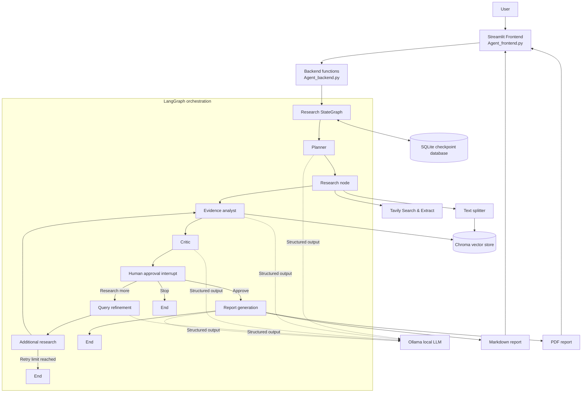
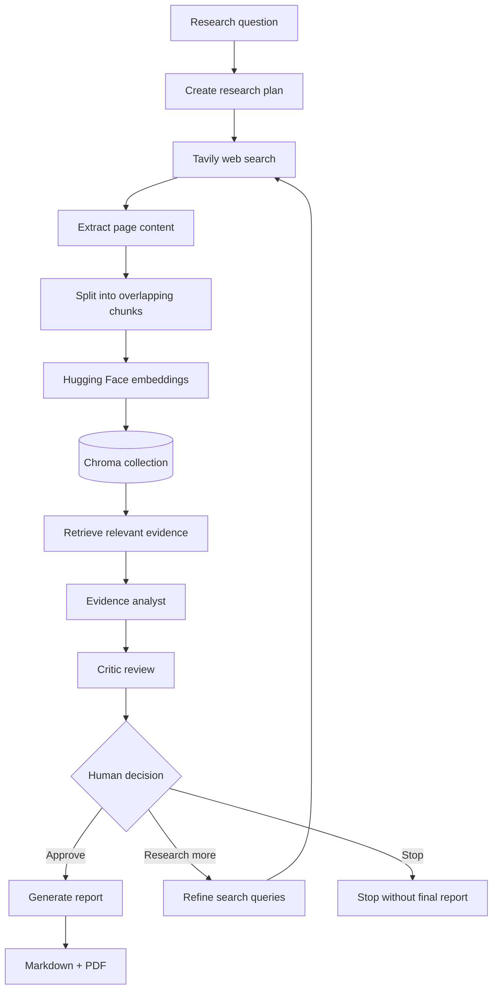

🔬 Autonomous Research Agent
An evidence-grounded, human-in-the-loop research application that plans
a research task, searches the web, extracts and indexes source content,
analyzes retrieved evidence, critiques the draft, and generates
downloadable Markdown and PDF reports.

The application uses Streamlit for its interface and LangGraph
to orchestrate the research workflow. The language model runs locally
through Ollama; web search and extraction are provided by
Tavily.
Important: The LLM and vector database can run locally, but web
research still requires an internet connection and a Tavily API key.
The Hugging Face embedding model may also need to be downloaded the
first time it is used.

Contents
- What it does
- Features
- Architecture
- Research workflow
- Technology stack
- Project structure
- Prerequisites
- Installation and setup
- Configuration
- Running the application
- Human review and retry
  behaviour
- Storage and generated files
- Limitations and security notes
- Troubleshooting
What it does
Give the application a research question. It asks a local LLM to turn
that question into focused research questions and search queries. It
then searches the web with Tavily, extracts page content, splits the
content into overlapping text chunks, stores those chunks in Chroma, and
retrieves the most relevant evidence for analysis.

A separate critic step checks the proposed answer for unsupported
claims, missing information, and contradictions. The user then decides
whether to approve the work, request another research cycle, or stop.
Once approved, the system creates a structured research report in
Markdown and PDF formats.

The application is designed to make the research process inspectable: it
displays progress, shows the current answer and critic feedback, exposes
source URLs for findings, and asks for human approval before report
generation.
Features
- Research planning: generates 3--8 research questions and 3--8
  focused search queries from the user's prompt.
- Web search: uses Tavily's advanced search mode to find relevant
  pages.
- Content extraction: attempts to extract content from up to five
  result URLs per research cycle.
- Source deduplication: removes duplicate search results based on
  URL.
- Text chunking: uses RecursiveCharacterTextSplitter with a
  1,200-character chunk size and 200-character overlap.
- Semantic retrieval: embeds chunks and stores them in a
  persistent Chroma collection; retrieves the configured top-k
  evidence blocks.
- Evidence-grounded analysis: instructs the analyst to use the
  supplied evidence, identify supporting source URLs, and state
  limitations rather than guessing.
- Critic review: evaluates unsupported claims, missing
  information, contradictions, and overall answer quality on a 0--10
  scale.
- Human-in-the-loop control: the user can approve, request more
  research, or stop at the review checkpoint.
- Iterative research: critic feedback is used to create more
  targeted search queries for additional research.
- Live progress display: Streamlit shows workflow stages and
  status updates while the backend runs in a single worker thread.
- Persistent graph checkpoints: LangGraph state is checkpointed in
  a local SQLite database.
- Report generation: produces a structured Markdown report and a
  PDF report.
- Local LLM inference: uses Ollama through LangChain's
  ChatOllama integration.
Architecture
High-level component architecture

Main research data flow

Research workflow
  Stage                               What happens
  1. Planning                        The local LLM creates research
questions and search queries using
a structured Pydantic schema.

  2. Web research                    Tavily searches each query. Search
results are deduplicated by URL.

  3. Extraction                      The backend attempts to extract
content from up to five result
URLs.

  4. Chunking                        Extracted text is split into chunks
of 1,200 characters with 200
characters of overlap. If
extraction produces no chunks,
available search-result snippets
are used as a fallback.

  5. Indexing                        Hugging Face embeddings convert
chunks into vectors, which are
stored in Chroma with URL, chunk,
source, and thread metadata.

  6. Retrieval                       Chroma retrieves the top
RETRIEVER_K chunks for the
original research question,
filtered by the current thread ID.

  7. Evidence analysis               The analyst produces an answer,
findings with supporting source
URLs, an evidence-sufficiency flag,
and limitations.

  8. Critic review                   The critic checks the answer
against the supplied evidence and
returns a score, approval
assessment, unsupported claims,
omissions, contradictions, and
feedback.

  9. Human review                    The workflow pauses. The user can
approve, request more research, or
stop.

  10. Query refinement               If more research is requested, the
local LLM uses critic feedback and
missing information to create
targeted queries.
11. Report generation              After human approval, the report
writer creates a structured report
and saves Markdown and PDF files.
The critic's approved value is displayed in the interface, but the
workflow's next step is selected by the human decision. The critic
does not automatically bypass the human review checkpoint.
Technology stack
  Area                    Technology                                 Role in this project
  User interface          Streamlit                                  Research input,
settings, live
progress, human review,
results, and downloads

  Workflow orchestration  LangGraph                                  Defines nodes,
transitions,
conditional routes,
interrupts, and
resumable workflow
state

  LLM runtime             Ollama                                     Runs the configured
language model locally

  Default LLM             qwen2.5:3b                               Default model name when
OLLAMA_MODEL is not
configured

  LLM integration         LangChain ChatOllama                     Connects the backend to
Ollama

  Web search and          Tavily                                     Finds web pages and
extraction                                                         extracts page content

  Embeddings              Hugging Face                               Converts text chunks
sentence-transformers/all-MiniLM-L6-v2   into embeddings

  Vector database         Chroma                                     Persists and retrieves
semantically relevant
research chunks

  Text processing         LangChain text splitters                   Splits extracted
content into
overlapping chunks

  Data validation         Pydantic                                   Defines structured
outputs for planning,
analysis, critique,
refinement, and reports

  Workflow persistence    SQLite + LangGraph SqliteSaver           Saves graph checkpoints
for interrupt/resume
behaviour

  PDF creation            ReportLab                                  Builds downloadable A4
PDF reports
Environment             python-dotenv                              Loads local environment
configuration                                                      variables from .env
Project structure
The following is the logical structure expected by the backend. Some
directories are created automatically when the backend starts.
project-root/
├── Agent_backend.py          # Research pipeline and LangGraph workflow
├── Agent_frontend.py         # Streamlit user interface
├── requirements.txt          # Python dependencies
├── .env                      # Local secrets/configuration (do not commit)
├── .env.example              # Safe configuration template (commit this)
├── .gitignore                # Excludes secrets and generated/local data
│
├── data/
│   └── chroma/               # Persistent Chroma vector-store data
│
├── checkpoints/
│   └── research_agent.db     # SQLite LangGraph checkpoints
│
└── reports/
    ├── <thread_id>.md        # Generated Markdown reports
    └── <thread_id>.pdf       # Generated PDF reports
data/chroma, checkpoints, and reports are created by the backend
if they do not already exist. The exact project root may contain
additional notebooks or development files.
Prerequisites
- Python installed (use a version supported by the packages in
  requirements.txt).
- Git, if you plan to clone or version-control the project.
- Ollama installed and running locally.
- The Ollama model configured for the project downloaded locally.
- A Tavily API key for web search and extraction.
- Internet access for Tavily and, on first use if not cached, the
  Hugging Face embedding model.
Ollama setup
Install Ollama from ollama.com, then pull the
default model:
ollama pull qwen2.5:3b
Make sure the Ollama service is running. The backend's default endpoint
is:
http://localhost:11434
If you configure a different model, pull that model and set
OLLAMA_MODEL accordingly.
Installation and setup
1. Open the project directory
Open the folder containing Agent_backend.py, Agent_frontend.py, and
requirements.txt in a terminal.
2. Create and activate a virtual environment
Windows PowerShell:
python -m venv .venv
.venv\Scripts\Activate.ps1
Windows Command Prompt:
python -m venv .venv
.venv\Scripts\activate.bat
macOS / Linux:
python -m venv .venv
source .venv/bin/activate
3. Install dependencies
python -m pip install --upgrade pip
pip install -r requirements.txt
4. Configure environment variables
Create a .env file in the project root. See the configuration section
below.
5. Start Ollama and ensure the model is available
ollama list
If the configured model is missing, pull it with
ollama pull <model-name>.
6. Start the Streamlit application
streamlit run Agent_frontend.py
Streamlit will print a local URL in the terminal (commonly
http://localhost:8501). Open that URL in your browser.
Configuration
The backend reads these environment variables. Defaults shown below are
taken from the backend configuration.
  Variable                Purpose                 Default
  TAVILY_API_KEY        Required Tavily API key No default; required for web search

  OLLAMA_MODEL          Ollama model name       qwen2.5:3b

  OLLAMA_BASE_URL       Ollama server endpoint  http://localhost:11434

  EMBEDDING_MODEL       Hugging Face embedding  sentence-transformers/all-MiniLM-L6-v2
model                   

  CHROMA_COLLECTION     Chroma collection name  autonomous_research_documents

  RETRIEVER_K           Number of evidence      8
chunks to retrieve      
MAX_RETRIES           Backend default for     2
additional research
cycles
Example .env.example:
TAVILY_API_KEY=replace_with_your_tavily_api_key
OLLAMA_MODEL=qwen2.5:3b
OLLAMA_BASE_URL=http://localhost:11434
EMBEDDING_MODEL=sentence-transformers/all-MiniLM-L6-v2
CHROMA_COLLECTION=autonomous_research_documents
RETRIEVER_K=8
MAX_RETRIES=2
Copy .env.example to .env and replace the Tavily placeholder with
your own key. Do not commit .env.
Running the application
1. Start Ollama and confirm the configured model is available.
2. Activate the project's virtual environment.
3. Run streamlit run Agent_frontend.py.
4. Enter a research question in the text area.
5. Optionally set Maximum re-research attempts in Research Settings
   (the UI slider allows 0--3).
6. Select Start Research.
7. Follow the progress cards as the planner, web research, analysis,
   and critic stages run.
8. At Human Review, inspect the current answer, critic score,
   evidence-sufficiency indicator, and critic feedback.
9. Choose one of the available actions:
   - Approve & Generate --- continue to report generation.
   - Research More --- refine the queries using critic feedback
     and run another research cycle, subject to the configured retry
     limit.
   - Stop --- end the workflow without generating a final report.
10. When report generation completes, review the report in the app and
    use the Markdown or PDF download buttons.
Human review and retry behaviour
The backend uses LangGraph's interrupt() to pause execution at the
human approval node. The Streamlit frontend checks whether the graph is
waiting at that node and presents the three decisions.

The graph resumes using Command(resume=decision) and the same
LangGraph thread ID. A SQLite checkpointer stores graph state so the
interrupted workflow can continue.

When the user requests more research:
1. The retry counter is incremented.
2. The query-refinement chain reads the critic feedback and
   missing-information list.
3. It generates 2--4 targeted search queries.
4. Tavily searches and extracts additional sources.
5. New chunks are added to Chroma under the same thread ID.
6. Relevant evidence is retrieved again.
7. The analyst and critic run again before the next human decision.
The UI runs the long-running research call through a
ThreadPoolExecutor with one worker. This is intended to avoid multiple
simultaneous local LLM and embedding jobs competing for limited laptop
resources.
Storage and generated files
  Location                            Contents
  data/chroma/                      Persistent Chroma vector-store
files

  checkpoints/research_agent.db     SQLite database used by LangGraph's
checkpointer

  reports/<thread_id>.md            Generated Markdown report
reports/<thread_id>.pdf           Generated PDF report
The backend filters vector retrieval by thread_id, which helps keep
evidence retrieval scoped to the current research run. The progress
tracker itself is an in-memory Python dictionary; its progress history
is not a persistent job-history database.
Limitations and security notes
- Not fully offline: Ollama inference is local, but Tavily search
  and extraction require internet access and a valid API key.
- Evidence quality depends on sources: search results and
  extracted pages may be incomplete, outdated, inaccessible, or
  inaccurate. Human review remains important.
- A critic is not a guarantee of correctness: the critic is
  another LLM step. Its score and approval assessment should be
  treated as review assistance, not proof that every claim is correct.
- Extraction fallback: if page extraction yields no chunks, the
  backend falls back to search-result snippets. Snippets may contain
  less context than full pages.
- No authentication is implemented in the supplied frontend: do
  not expose the Streamlit app publicly without adding suitable
  authentication, authorization, network controls, and deployment
  hardening.
- Protect API keys: keep .env out of Git. If a key is
  accidentally committed, revoke/rotate it; deleting the file in a
  later commit does not remove it from Git history.
- Local data may be sensitive: Chroma data, SQLite checkpoints,
  and generated reports can contain research questions and retrieved
  content. Treat them accordingly.
- Model and hardware requirements vary: response speed and memory
  use depend on the chosen Ollama model, embedding model, and
  available hardware.
Troubleshooting
  Problem                                 Things to check
  TAVILY_API_KEY is missing from .env   Confirm .env is in the project
root and contains
TAVILY_API_KEY=....

  Cannot connect to Ollama                Start Ollama, check the configured
base URL, and verify the service is
reachable.

  Model not found                         Run ollama list; pull the
configured model if it is missing.

  Missing Python module                   Activate the correct virtual
environment and run
pip install -r requirements.txt.

  Hugging Face model download fails       Check internet connectivity and
available disk space; retry after
connectivity is restored.

  Tavily search or extraction fails       Check the API key, account
access/limits, internet connection,
and the failing URL.

  No evidence retrieved                   Check whether search/extraction
returned content, whether chunks
were indexed, and whether the
current thread ID is being used
consistently.

  PDF or Markdown report is missing       Check the terminal for errors and
confirm the application can write to
the reports/ directory.
Old local data causes unexpected        Back up the relevant data first;
results                                 only then consider clearing the
Chroma or checkpoint data. Removing
these directories can delete stored
vectors or resumable workflow state.
Current implementation notes
This README describes the supplied Agent_backend.py and
Agent_frontend.py code:
- The backend is a single Python module that builds and compiles the
  LangGraph workflow.
- The frontend imports the backend functions directly; there is no
  separate HTTP API server in the supplied implementation.
- MCP is not included in this implementation.
- The backend creates the Chroma, checkpoint, and report directories
  at startup.
- The generated report contains an executive summary, research
  question, key findings, detailed analysis, evidence source URLs,
  limitations, and conclusion.
License
No license was specified in the supplied project files. Add a LICENSE
file before publishing if you want to grant others explicit permission
to use, modify, and distribute this project.

